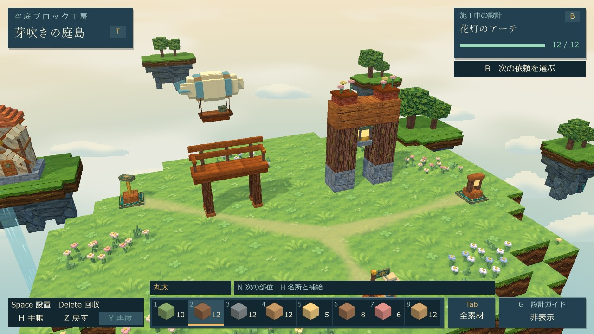

# 空庭ブロック工房

最初の施工は「風待ちのベンチ」です。Bの設計帳で完成見本を選ぶと、島にガイドが表示されます。Gで表示を切り替えられます。丸太の脚、蜂蜜板の梁、北向きの座面の順に組むと、見本の立体と少しずつ合っていきます。初めてならNで次の部位を呼び出し、Spaceで置く操作から試せます。

| やりたいこと | 操作 |
| --- | --- |
| 面にブロックを付ける | 素材を選び、地面かブロックの面を左クリック。Shift＋左クリックで設置したブロックを回収します。 |
| 素材や設計を選ぶ | Tabで素材帳、Bで設計帳、Gで設計ガイド。段や風見羽はRで90度ずつ回転できます。 |
| 設計を進める | Nで次の部位を選び、Spaceで設置。Vで設計全体を回転、完成したらEnterで出品します。Zで取り消し、Yでやり直し。 |
| 視点と島の移動 | WASDで注視点を移動。右ドラッグまたはQ・Eで旋回、ホイールで拡縮。Tで渡航先、Hで作業手帳を開きます。 |
| キーボードで組む | I・J・K・Lで格子カーソルを水平に移動し、U・Oで高さを調整。Deleteで回収、Cで目の前の素材を選べます。 |
| 記録する | F8で操作表示を外した島の絵はがきを保存し、F9でその記録のアルバムを開けます。F12は操作表示を含む画面写真です。 |

芽吹きの庭島、琥珀の風車島、群青の星晶島にはそれぞれ異なる素材があります。桟橋と名所に近づきFで補給すると、丸太や草土からガラス・赤銅・星晶まで、16素材を建築に使えます。1件完工すると琥珀の風車島、3件で群青の星晶島が航路に加わります。施工は設計図に記された場所・素材・向きで判定します。6件を仕上げると素材数無制限の自由建築が開き、巡回依頼にも取り組めます。巡回で指定部位をすべて自分で施工すると、設計ごとに最少手数が記録されます。

## 手動で調整する

- [Voxel.unity](../Assets/Games/Voxel/Voxel.unity) を開き、**潮彩作品集 → 空庭の設計図を描く** を選びます。「複製して新しい依頼を作る」で元の設計を残し、新しいID、依頼名、施工する島と原点を指定します。
- 編集画面の高さ0は地面に置く段です。素材を選び、上の層へ切り替えながら左クリックで追加、右クリックで消去します。方向のある部材は北・東・南・西も指定できます。ウィンドウを横に広げると、右側に積み上がった形の立体見本が現れます。「検証して保存」を押すと [Workshop.json](../Assets/Games/Voxel/Resources/Voxel/Workshop.json) に書き出されます。
- 同じJSONの `materials` で素材の名前、色、入手地点、初期数、補給量と回転の有無を編集できます。既存の島や依頼を引き継ぐ場合は素材IDと設計IDを保ちます。独自の設計画は `Assets/Games/Voxel/Resources/Voxel/Plans/` に設計IDと同名のPNGを置けます。
