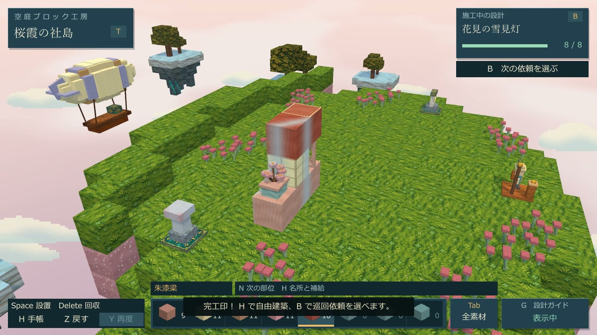

# Eブロック建築ゲーム

空庭ブロック工房

丸太や板を一つずつ組んで、空に浮かぶ島にベンチや橋、水車を建てます。見本を回して構造を確かめ、部材の位置や向きを合わせる立体の建築ゲームです。

**[ブラウザーで遊ぶ](https://kaxic.github.io/shiosai-sky-garden/)** ・ [A〜Fのゲーム一覧](https://kaxic.github.io/shiosai-game-library/#E)

[実際のプレイ映像を見る](https://kaxic.github.io/shiosai-sky-garden/media/demo.mp4)

## 最初にすること

設計帳で「風待ちのベンチ」を選びましょう。「次の部位」で丸太の脚を呼び出して設置。ガイドに沿って梁を渡し、北向きの座面を並べたら、完成したベンチを出品します。

## 遊びの流れ

島の桟橋や名所で材料を補給し、設計図の形に合わせて積み上げます。視点を回せば裏側や高さも確認できます。一度置いた部材は取り消せるので、向きのある板や段もじっくり合わせられます。

## 目指すもの

最初のベンチを出品すると2番目の島へ渡れます。設計を仕上げていくと、全6島で32種類の素材が使えます。12件の設計を仕上げると、材料の残りを気にせず自由に建築できます。巡回依頼では設計ごとの最少手数も記録されます。

[遊び方と手動で拡張する方法](Guides/Voxel.md)

## Unityで開く

Unity Hubでこのフォルダーを追加し、Unity 6000.3.28f1で `Assets/Games/Voxel/Voxel.unity` を開いて再生します。

Web版は Web Build Support を追加し、Unity の **Shiosai → Build browser game** から再ビルドできます。出力先は `docs` です。

[拡張版の内容](更新内容.md) ・ [Windows版をダウンロード](https://github.com/kaxic/shiosai-sky-garden/releases/latest)
